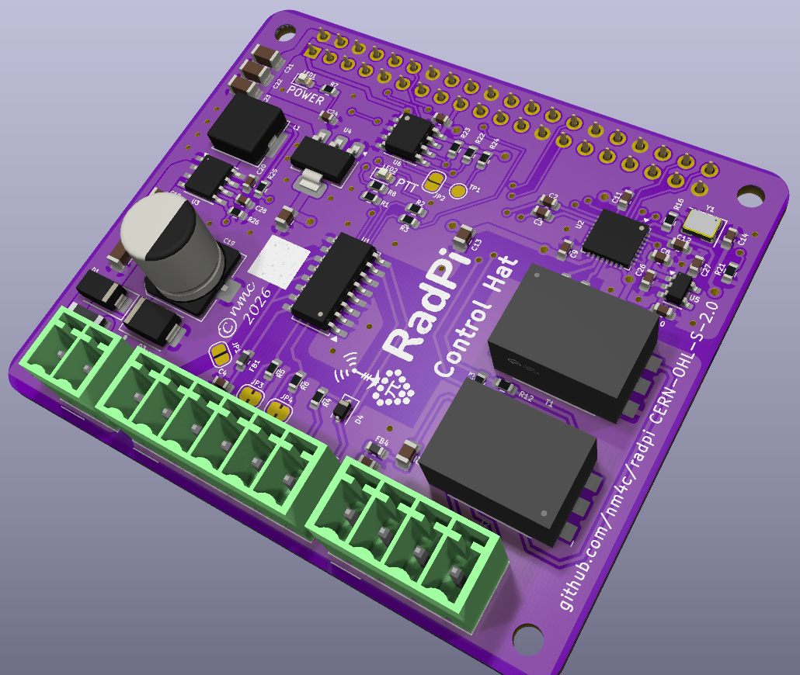

# RadPi Control HAT

A Raspberry Pi HAT that replaces the hand-wired interface in [`../docs/HARDWARE.md`](../docs/HARDWARE.md).
It has everything on one board:

- **Opto-isolated control:** PTT, channel UP/DOWN and BUSY through a TCMT4100.
- **On-board sound card:** a TLV320AIC3104 I2S codec, with isolation transformers to the radio's
  mic input and speaker.
- **Power:** a 13.8 V input with protection, and a 5 V buck that also powers the Pi.
- **HAT ID EEPROM:** tells the Pi which sound-card overlay to load at boot.

<p align="center">
  
</p>

| File | What it is |
|---|---|
| `pihat.kicad_pro` / `.kicad_sch` / `.kicad_pcb` | KiCad project |
| [`docs/schematic/radpi-control-hat.html`](docs/schematic/radpi-control-hat.html) | Reference schematic: 7 sheets, netlist, parts, pre-layout checks. Open it in a browser. |
| [`docs/BOM.md`](docs/BOM.md) | BoM notes and cost summary |
| [`docs/jlc-bom.csv`](docs/jlc-bom.csv) | JLCPCB assembly BoM |
| `docs/schematic/gen.py` | Regenerates the schematic page and the CSV from one parts list |
| [`docs/schematic.svg`](docs/schematic.svg) | The KiCad schematic, all sheets on one page (made by `tools/kicad/overview.py`) |

## Schematic

[](docs/schematic.svg)

The whole circuit on one page, straight from the KiCad schematic (click to open it full size; part
and net names are searchable). Labels with the same name are connected. Regenerate it with
`python3 tools/kicad/overview.py` after changing the schematic.

## Software

**Pi set-up (Pi 4 or Pi 5):** from the git clone,

```
sudo ./deploy/setup-hat.sh control
sudo reboot
sudo ./deploy/setup-hat.sh --check
```

(or `sudo ./deploy/install.sh --hat control` on a new install). It installs the codec overlay
(`deploy/overlays/radpi-codec.dts`: the `tlv320aic3x` driver already in Raspberry Pi OS, codec at
I2C 0x18, reset on GPIO26, clocked from Y1's 12 MHz and driving the I2S clocks), and at the next boot
sets the codec's inputs and outputs (`deploy/radpi-mixer.sh control`: LINE1L in, HPLOUT and HPLCOM
differential into T1). The server finds the sound card ("RadPi") by itself. In `config.yaml`:
`radio.type: buttons`, the channels, and `gpio.busy_pin: 23` with `busy_pull_up: true` if the
radio's busy line is wired to BS+/BS-. Don't use the stock `dacberry400` overlay: its driver clocks
the codec's PLL from BCLK while telling it the clock is 12 MHz, so the sample rate would be wrong.

**Powering:** the HAT powers the Pi through header pins 2 and 4. Don't power the Pi from its USB-C
socket while the HAT is fitted and its 13.8 V input is off: the Pi's 5 V would then sit on the
buck's output with no input, which the LMR33640 datasheet says not to allow.

## Licence

The hardware design in this folder is licensed under the **CERN Open Hardware Licence v2, Strongly
Reciprocal (CERN-OHL-S-2.0)**. See [`LICENSE`](LICENSE). The generator scripts in `tools/` and
`docs/schematic/gen.py` are software and are GPL-3.0-or-later (see the repository root).

CERN-OHL-S asks that products made from the design say where the source can be found. Put this on
the board's silkscreen during layout, for example:

    RadPi Control HAT  CERN-OHL-S-2.0  github.com/nm4c/radpi
